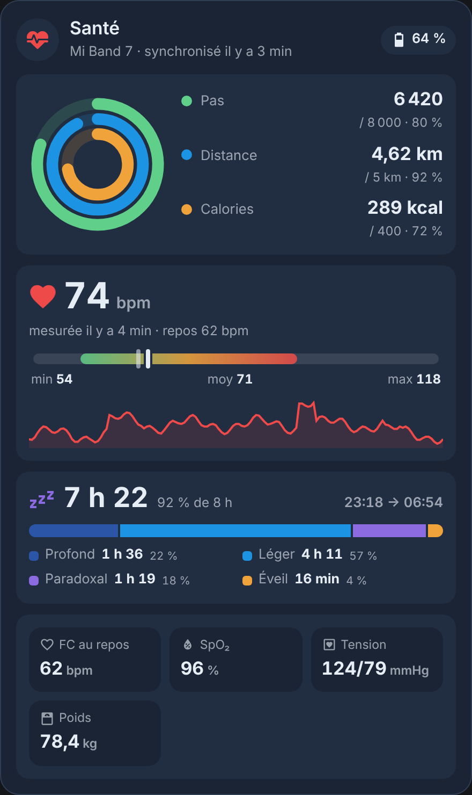
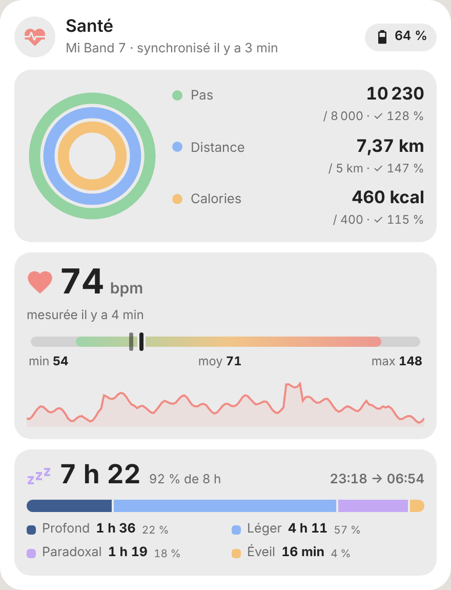
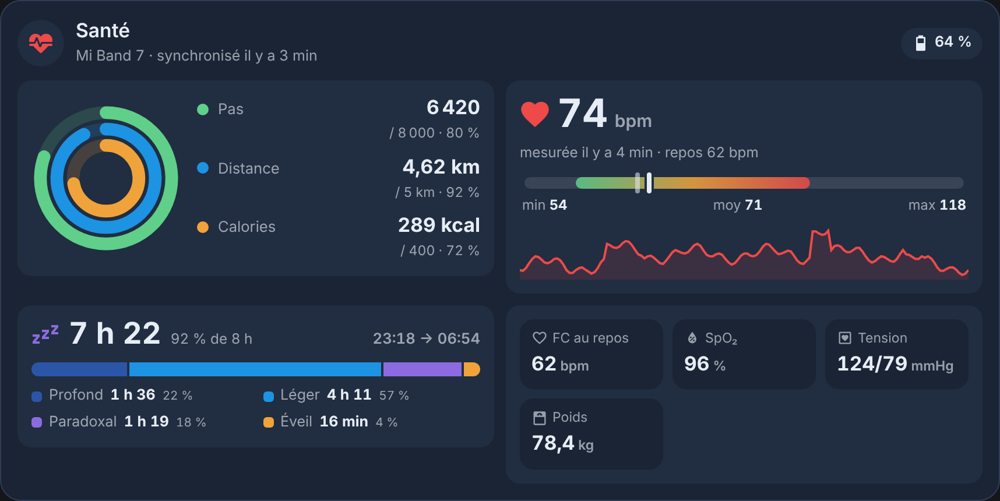

<p>
  ☕ <strong>Si cette carte vous est utile, vous pouvez soutenir le projet :</strong>
</p>

<div style="white-space: nowrap; line-height: 0;">
  <a
    href="https://www.buymeacoffee.com/Marlboro62"
    target="_blank"
    rel="noopener noreferrer"
    style="display: inline-block; text-decoration: none; vertical-align: middle;"
  ></a>&nbsp;&nbsp;<a
    href="https://ko-fi.com/M4M2QL45X"
    target="_blank"
    rel="noopener noreferrer"
    style="display: inline-block; text-decoration: none; vertical-align: middle;"
  ></a>
</div>


# Carte Santé

[](https://hacs.xyz/docs/faq/custom_repositories)
[](https://github.com/Marlboro62/sante-card/releases)

Carte Lovelace pour Home Assistant qui réunit sur un seul écran l'**activité**, la **fréquence cardiaque** et le **sommeil** mesurés par un **Xiaomi Mi Band 7** (intégration [Mi Band 7](https://github.com/Marlboro62/ha-miband)), complétés si vous le souhaitez par les mesures **Health Connect** de votre téléphone (application Home Assistant) : oxygène, FC au repos, tension, poids…

| Sombre | Clair (thème pastel), objectifs atteints | Tablette / PC |
| --- | --- | --- |
|  |  |  |

*Aperçus réalisés avec la démo et des données fictives.*

**[▶ Essayer la démo en ligne](https://marlboro62.github.io/sante-card/docs/demo.html)** : la carte avec des données simulées, en clair ou en sombre, avec le YAML à copier.

## Ce que montre la carte

- **Activité** : trois anneaux, pas, distance et calories du jour, avec le pourcentage de vos objectifs.
- **Cœur** : dernière mesure, plage du jour (minimum, moyenne, maximum), courbe des dernières 24 h.
- **Sommeil** : durée de la dernière nuit et part de l'objectif, phases (profond, léger, paradoxal, éveil), heures d'endormissement et de réveil.
- **Mesures du téléphone** (facultatif) : FC au repos, SpO₂, variabilité de la FC, respiration, tension, poids, masse grasse, glycémie, température, VO₂ max, étages, hydratation, quand Health Connect les fournit.
- En haut : batterie du bracelet, « Endormi », « Non porté », dernière synchronisation.

Un clic sur une valeur ouvre son historique.

## Installation

### Avec HACS (recommandé)

1. Dans HACS, cherchez **Carte Santé** et installez-la.
2. Rechargez la page (Ctrl+F5).

Si la carte n'apparaît pas encore dans la recherche de HACS, ajoutez le dépôt à la main : menu **⋮** → **Dépôts personnalisés**, adresse `https://github.com/Marlboro62/sante-card`, type **Tableau de bord** (Dashboard), puis cherchez **Carte Santé**.

### Manuellement

1. Téléchargez [`sante-card.js`](https://raw.githubusercontent.com/Marlboro62/sante-card/main/sante-card.js) (clic droit → Enregistrer sous) et copiez-le dans `/config/www/`.
2. **Paramètres → Tableaux de bord → ⋮ → Ressources → Ajouter une ressource** : URL `/local/sante-card.js`, type **Module JavaScript**.
3. Rechargez la page (Ctrl+F5).

## Configuration

Le Mi Band est trouvé seul : la carte suffit.

```yaml
type: custom:sante-card
```

Tout se règle aussi dans l'éditeur visuel.

| Option | Par défaut | Rôle |
| --- | --- | --- |
| `title` | `Santé` | Titre |
| `icon` | `mdi:heart-pulse` | Icône |
| `device` | le premier trouvé | Bracelet Mi Band (identifiant d'appareil), si vous en avez plusieurs |
| `phone` | aucun | Téléphone dont afficher les mesures Health Connect (identifiant d'appareil). **Jamais deviné**, pour ne pas montrer la santé d'un autre membre du foyer |
| `step_goal` | `8000` | Objectif de pas |
| `distance_goal` | `5` | Objectif de distance, en km |
| `calorie_goal` | `400` | Objectif de calories, en kcal |
| `sleep_goal` | `8` | Objectif de sommeil, en heures |
| `show_activity` / `show_heart` / `show_sleep` / `show_phone` | `true` | Afficher ou masquer chaque partie |
| `theme` | `maison` | `maison` (pastel, suit votre thème), `v2` (bleu nuit), `auto` (clair ou sombre selon Home Assistant), `ha` (couleurs du thème Home Assistant) |
| `entities` | | Remplacer un capteur trouvé : `steps`, `distance`, `calories`, `heart_rate`, `heart_rate_min`, `heart_rate_max`, `heart_rate_avg`, `sleep_total`, `sleep_deep`, `sleep_light`, `sleep_rem`, `sleep_awake`, `sleep_start`, `sleep_end`, `battery`, `last_sync` |

Les valeurs du Mi Band passent avant celles du téléphone ; le téléphone complète ce que le bracelet ne fournit pas.

## Confidentialité

La carte n'affiche aucune position, adresse ni identifiant réseau, même si le téléphone choisi en fournit. Avant de publier une capture de votre tableau de bord, vérifiez qu'elle ne montre pas de noms ou d'informations personnelles.

## Support

Problèmes et idées : [issues GitHub](https://github.com/Marlboro62/sante-card/issues).

## Licence

MIT
